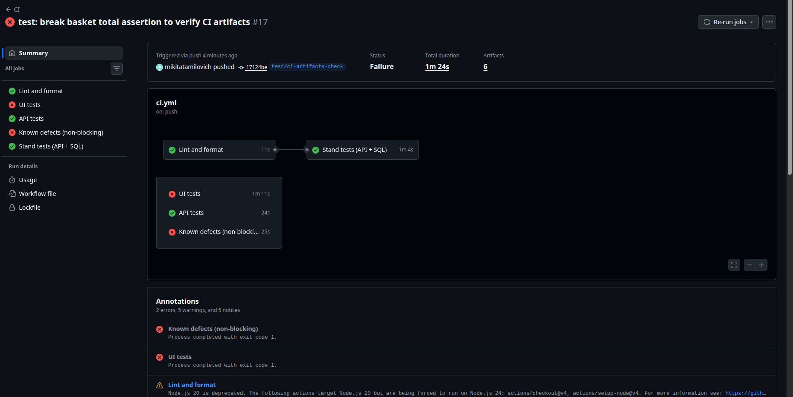
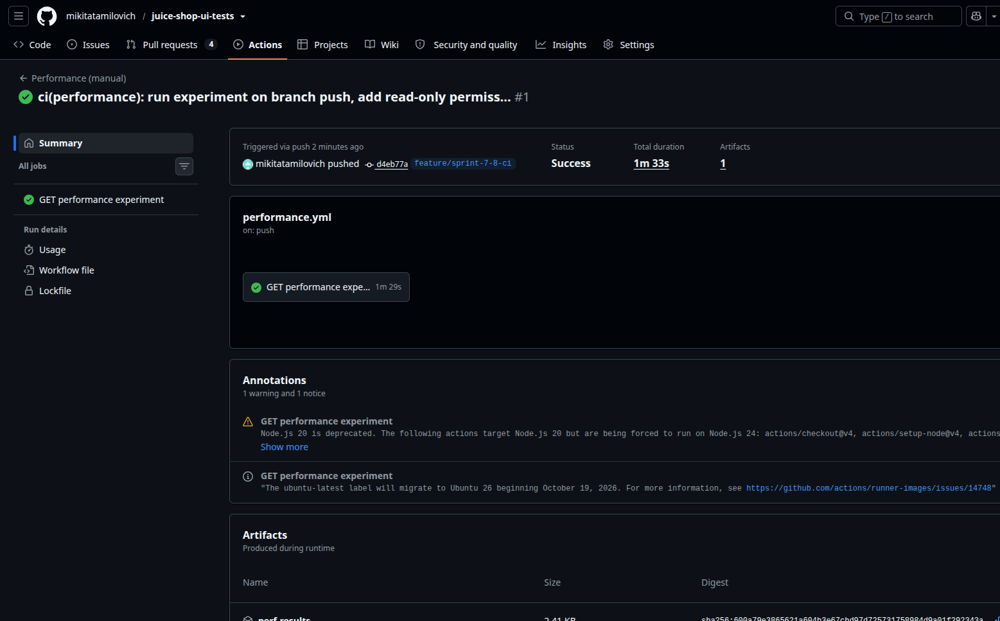
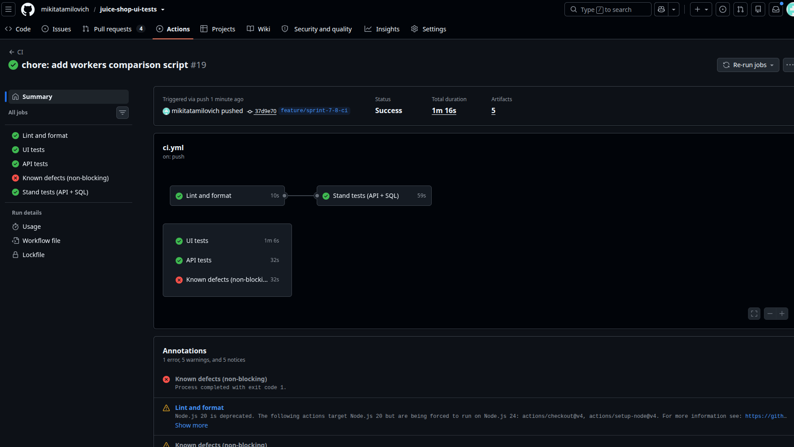

# Отчёт по спринтам 7–8: Reporting, Database, Stability & Performance

Проект: `juice-shop-ui-tests` (Playwright, JavaScript). Стенд для частей 2 и 5: React API Data Sample (Express + PostgreSQL + Prisma). Ветка: `feature/sprint-7-8-ci`.

Статус разделов: ✅ выполнено и подтверждено.

| Часть | Тема                                | Статус |
| ----- | ----------------------------------- | ------ |
| 1     | Test Reporting                      | ✅     |
| 2     | Database Testing + SQL              | ✅     |
| 3     | Test Framework Refactoring          | ✅     |
| 4     | Test Isolation & Parallel Execution | ✅     |
| 5     | Basic Performance Testing           | ✅     |
| 6     | Интеграция в CI                     | ✅     |
| 7     | Дополнительные задания              | ✅     |

## Структура проекта

```
.github/workflows/   ci.yml, performance.yml (ручной запуск)
config/              constants.js, api.constants.js, stand.constants.js
docs/                sql-queries.md, sql-run.sql, sql-results.txt
src/api/             клиенты API (Juice Shop и стенда: tasks.js)
src/data/            генерация уникальных данных задач (task.js)
src/db/              подключение к PostgreSQL и SQL-функции (index.js)
src/fixtures/        index.js, api.js, stand.js (db, api, createdIds, createTask)
src/pages/           Page Objects
src/utils/           perf.js, stats.js и другие
tests/ui/            UI-тесты
tests/api/           API-тесты Juice Shop
tests/stand/         tasks.api.spec.js, tasks.db.spec.js
tests/performance/   tasks.perf.spec.js
tools/               run-isolation.sh, run-workers-comparison.sh
```

---

## Часть 1. Test Reporting ✅

### Настройка

В `playwright.config.js`: `reporter: [['list'], ['html', { open: 'never' }]]`; для project `ui`: `screenshot: 'only-on-failure'` и `trace: 'retain-on-failure'`. К упавшему UI-тесту Playwright прикладывает скриншот (`test-failed-1.png`), `trace.zip` и `error-context.md`; все они доступны из HTML-отчёта.

Дополнительные материалы через `testInfo.attach`: результаты performance-эксперимента (`perf-results.md`) прикрепляются к отчёту из теста `tasks.perf.spec.js`.

### Намеренно сломанный assertion

В `tests/ui/basket.spec.js` в первом тесте ожидаемая сумма заменена с `EXPECTED.priceOne` на неверное значение: `await basketPage.expectTotalPrice(999.9);`.

Запуск: `npx playwright test --project=ui tests/ui/basket.spec.js --retries=0`. Результат: 3 passed, 1 failed, 9.5 с. Затем файл возвращён (`git checkout`).

### Разбор падения

- **Тест:** `should show added product and total price in basket` (`tests/ui/basket.spec.js:4`), в отчёте помечен красным, рядом ссылка View Trace.
- **Сообщение об ошибке** (HTML-отчёт и консоль): `expect(locator).toBeVisible() failed`, локатор `getByText('Total Price: 999.9')`, ожидалось «visible», таймаут 5000 мс, «element(s) not found». Место: `src/pages/BasketPage.js:78` (метод `expectTotalPrice`), вызов из `basket.spec.js:13`.
- **Шаги в trace:** предыдущие действия выполнены успешно: клик по карточке товара, появление уведомления «Placed Apple Juice (1000ml) into basket», клик по кнопке корзины, видимая строка товара, доступная кнопка Checkout. Только последнее действие `Expect "toBeVisible" getByText('Total Price: 999.9')` заняло 5.0 с (остальные миллисекунды), то есть Playwright ждал элемент весь таймаут; во вкладке Errors одна ошибка.
- **Снимок страницы в trace:** `http://127.0.0.1:3000/#/basket`, в корзине Apple Juice (1000ml), количество 1, цена 1.99; надпись «Total Price: 1.99». Вкладка Network показывает 61 запрос, вкладка Errors одну ошибку (ту же самую).


- **Причина падения:** ожидаемая сумма в тесте (999.9) не совпадает с фактической (1.99). Подготовка данных, авторизация, добавление товара и открытие корзины работают, проблема только в значении assertion (в этом сценарии это намеренная поломка). Исправление: вернуть `EXPECTED.priceOne`.

Все выводы сделаны по отчёту и trace без повторного запуска теста вручную, в этом и состоит смысл диагностики.

Три остальных теста того же файла прошли при параллельном запуске на 4 воркерах. В корзине видно уникального пользователя (`qa.user.2f4db766@example.com`): каждый тест создаёт собственного.

### Дополнительный пример: диагностика по тексту ошибки

Первый запуск того же файла упал сразу у всех 4 тестов с ошибкой `NetworkError: User registration failed: <!DOCTYPE html>...`, в теле ответа была страница Next.js «404: This page could not be found.» по пути `/api/Users`. Так стало видно, что на порту 3000 вместо Juice Shop отвечает фронтенд учебного стенда (`taskmanager_frontend`), занявший порт. После `docker stop taskmanager_frontend` и запуска Juice Shop тесты заработали. Проблема найдена по сообщению об ошибке без отладки.

### Проверка в CI

Конфигурация CI (`ci.yml`): загрузка `playwright-report/` и `test-results/` (скриншоты, trace) выполняется шагами с условием `if: ${{ !cancelled() }}`, то есть и после падения тестов.

Подтверждение на практике: в отдельной ветке `test/ci-artifacts-check` намеренно сломан тот же assertion в `basket.spec.js` (запуск CI #17, commit `17124be`). Результат прогона:

- job `UI tests` завершился с ошибкой, как и задумано; `Lint and format`, `API tests` и `Stand tests (API + SQL)` зелёные;
- несмотря на падение, в прогоне сохранились 6 артефактов, среди них `playwright-report-ui` и `test-results-ui`;
- в `test-results-ui` для упавшего теста лежат `test-failed-1.png`, `trace.zip` и `error-context.md` и для первой попытки, и для повтора (`-retry1`); в `playwright-report-ui` есть `index.html` с отчётом и вложенными скриншотом и trace.



После проверки ветка удалена, сломанный assertion в основную ветку не попал.

---

## Часть 2. Database Testing + SQL ✅

### Стенд

- Запуск: `docker compose up postgres backend` (фронтенд стенда не поднимается, так как порт 3000 занят Juice Shop, а тестам стенда нужны только API и БД).
- API: `http://localhost:4000`, БД: PostgreSQL на порту 5433, таблица `"Task"`.
- Поля: `id`, `title`, `description`, `status` (TO_DO / IN_PROGRESS / PENDING / COMPLETED), `priority` (LOW / MEDIUM / HIGH), `dueDate`, `createdAt`, `deletedAt`.
- Мягкое удаление отражает поле `deletedAt`: `NULL` у активной записи, время удаления у удалённой.

> **Примечание об авторизации.** Демо-аккаунт из README стенда недоступен: домен Supabase-проекта автора не резолвится (`nslookup` → `NXDOMAIN`, backend: `getaddrinfo ENOTFOUND`). Использован собственный бесплатный Supabase-проект; пользователь создан с Auto Confirm. Параметры хранятся в `.env` (не в репозитории) и в GitHub Secrets для CI.

### 2.1 SQL-запросы

Запросы и вопросы к ним: `docs/sql-queries.md` (7 запросов: WHERE, ORDER BY, COUNT, GROUP BY, WHERE по датам, WHERE по `deletedAt`, JOIN).

В схеме одна таблица, связанных таблиц нет, поэтому JOIN выполнен с системным каталогом Postgres (`pg_enum`).

Запросы выполнены в psql командой `docker exec -i taskmanager_test_db psql -U taskmanager_postgres -d taskmanager_db < docs/sql-run.sql` (вывод сохранён в `docs/sql-results.txt`). Состояние БД: 30 активных задач из seed-данных, тестовых записей `qa-%` нет.

**1. WHERE: какие активные задачи сейчас в работе?**

```sql
SELECT id, title, priority FROM "Task"
WHERE status = 'IN_PROGRESS' AND "deletedAt" IS NULL;
```

```
 id |      title       | priority
----+------------------+----------
  4 | Task Four        | HIGH
  7 | Task Seven       | HIGH
 12 | Task Twelve      | LOW
 15 | Task Fifteen     | LOW
 19 | Task Nineteen    | HIGH
 22 | Task Twenty-Two  | LOW
 25 | Task Twenty-Five | LOW
 29 | Task Twenty-Nine | HIGH
(8 rows)
```

**2. ORDER BY: у каких 5 задач самый ранний срок?**

```sql
SELECT id, title, "dueDate" FROM "Task"
WHERE "deletedAt" IS NULL
ORDER BY "dueDate" ASC LIMIT 5;
```

```
 id |   title    |       dueDate
----+------------+---------------------
  1 | Task One   | 2024-01-01 00:00:00
  2 | Task Two   | 2024-02-01 00:00:00
  3 | Task Three | 2024-03-01 00:00:00
  4 | Task Four  | 2024-04-01 00:00:00
  5 | Task Five  | 2024-05-01 00:00:00
(5 rows)
```

**3. COUNT: сколько всего активных задач?**

```sql
SELECT COUNT(*) FROM "Task" WHERE "deletedAt" IS NULL;
```

```
 count
-------
    30
(1 row)
```

**4. GROUP BY: сколько активных задач в каждом статусе?**

```sql
SELECT status, COUNT(*) FROM "Task"
WHERE "deletedAt" IS NULL
GROUP BY status ORDER BY COUNT(*) DESC;
```

```
   status    | count
-------------+-------
 COMPLETED   |     9
 IN_PROGRESS |     8
 TO_DO       |     7
 PENDING     |     6
(4 rows)
```

Сумма по статусам 9 + 8 + 7 + 6 = 30 совпадает с запросом 3.

**5. Какие задачи просрочены и не завершены?**

```sql
SELECT id, title, "dueDate", status FROM "Task"
WHERE "dueDate" < NOW() AND status <> 'COMPLETED' AND "deletedAt" IS NULL;
```

Результат: 21 строка (id 1, 3, 4, 5, 7, 8, 9, 11, 12, 14, 15, 17, 18, 19, 21, 22, 24, 25, 27, 28, 29). Это все незавершённые задачи (7 + 8 + 6 = 21): сроки всех seed-задач лежат в 2024–2025 годах, то есть в прошлом.

```
 id |       title       |       dueDate       |   status
----+-------------------+---------------------+-------------
  1 | Task One          | 2024-01-01 00:00:00 | TO_DO
  3 | Task Three        | 2024-03-01 00:00:00 | PENDING
  4 | Task Four         | 2024-04-01 00:00:00 | IN_PROGRESS
  ... (ещё 18 строк, полный вывод в docs/sql-results.txt)
(21 rows)
```

**6. Какие записи помечены удалёнными и когда?**

```sql
SELECT id, title, "deletedAt" FROM "Task"
WHERE "deletedAt" IS NOT NULL
ORDER BY "deletedAt" DESC;
```

```
 id | title | deletedAt
----+-------+-----------
(0 rows)
```

0 строк: в seed-данных нет удалённых записей, а тестовые записи после прогона удаляются (см. «Очистку тестовых данных» ниже). Тот же запрос в тесте удаления подтверждает, что после `DELETE` через API поле `deletedAt` заполняется.

**7. JOIN: сколько активных задач в каждом статусе, включая пустые?**

```sql
SELECT e.enumlabel AS status, COUNT(t.id) AS tasks
FROM pg_enum e
JOIN pg_type ty ON ty.oid = e.enumtypid AND ty.typname = 'TaskStatus'
LEFT JOIN "Task" t ON t.status::text = e.enumlabel AND t."deletedAt" IS NULL
GROUP BY e.enumlabel, e.enumsortorder
ORDER BY e.enumsortorder;
```

```
   status    | tasks
-------------+-------
 TO_DO       |     7
 IN_PROGRESS |     8
 PENDING     |     6
 COMPLETED   |     9
(4 rows)
```

Числа совпадают с запросом 4; отличие в том, что статус без задач остался бы в выводе со значением 0.

### 2.2–2.3 Тесты API и БД

Последний запуск `npm run test:stand`: **8 passed**.

| Файл                | Тест                   | Что проверяет                                                                                                          |
| ------------------- | ---------------------- | ---------------------------------------------------------------------------------------------------------------------- |
| `tasks.api.spec.js` | список задач           | статус 200, массив, поля из Swagger, своя запись в списке                                                              |
| `tasks.api.spec.js` | задача по ID           | статус 200, значения полей                                                                                             |
| `tasks.api.spec.js` | создание               | статус 201, тело ответа, целочисленный `id`                                                                            |
| `tasks.api.spec.js` | создание без `title`   | статус 422                                                                                                             |
| `tasks.api.spec.js` | запрос без авторизации | статус **401**, сообщение `Authentication required. Please log in.`                                                    |
| `tasks.db.spec.js`  | создание               | после POST запись найдена в БД, сверено 6 полей (`title`, `description`, `status`, `priority`, `dueDate`, `deletedAt`) |
| `tasks.db.spec.js`  | обновление             | PUT 200, в БД новый `status`, остальные поля не изменились                                                             |
| `tasks.db.spec.js`  | удаление               | DELETE 204, GET по id → 404, в списке нет, в БД `deletedAt` заполнен                                                   |

Архитектура: SQL только в `src/db` (параметризованные запросы `$1`), подключение из `.env` (значения по умолчанию в `config/stand.constants.js`), клиент API в `src/api/tasks.js`, генерация данных с `qa-` + `crypto.randomUUID()` в `src/data`, фикстуры `db` и `api` (worker), `createTask` и `createdIds` (test) в `src/fixtures/stand.js`. Для ожидания записи в БД используется `expect.poll`.

Проверка по уникальным названиям: тесты не считают общее число задач в таблице (там есть стартовые данные и записи других тестов).

### Очистка тестовых данных

Фикстура `createdIds` после каждого теста (в том числе упавшего) для каждой созданной задачи:

1. удаляет её через API (мягкое удаление; статус 404 для уже удалённой тестом задачи допустим);
2. физически удаляет строку SQL-функцией `deleteTaskById` (только id, созданные этим тестом);
3. если API вернул неожиданный статус удаления, после обработки всех строк выбрасывается ошибка `Cleanup failed for tasks: ...`, а не молчаливый пропуск.

Очистка находится в одном месте (фикстура), а не в `afterEach` каждого spec-файла, поэтому её получают и тесты стенда, и performance-тест.

Доказательство (выполнено на версии очистки через `afterEach`, поведение при переносе в фикстуру не менялось). До прогона записи `qa-%` удалены вручную, затем запущен набор и выполнена проверка:

```
$ docker exec -it taskmanager_test_db psql -U taskmanager_postgres -d taskmanager_db \
    -c "DELETE FROM \"Task\" WHERE title LIKE 'qa-%';"
DELETE 4

$ npm run test:stand
  8 passed (3.4s)

$ docker exec -it taskmanager_test_db psql -U taskmanager_postgres -d taskmanager_db \
    -c "SELECT COUNT(*) FROM \"Task\" WHERE title LIKE 'qa-%';"
 count
-------
     0
(1 row)
```

Наблюдение, которое привело к строгой очистке: сначала в API-тестах очистка шла только через API, и в таблице оставались мягко удалённые записи (`deletedAt` не NULL). Они не мешали тестам, но копили мусор. После добавления физического удаления остаток стал 0.

---

## Часть 3. Test Framework Refactoring ✅

Ревью выполнено по файлам: `playwright.config.js`, `config/constants.js`, `src/fixtures/index.js`, `src/fixtures/api.js`, `src/api/http.js`, `src/utils/api.js`, Page Objects (`BasePage`, `LoginPage`, `BasketPage`, `ProductsPage`), `tests/ui/basket.spec.js`, `login.spec.js`, `products.spec.js` и кода стенда. Файлы `tests/api/*`, `popups.spec.js` и остальные модули `src/api`, `src/utils` в ревью не входили.

Фреймворк уже был в хорошем состоянии, поэтому переписывалось только оправданное.

### 3.1 API client и общие методы

Уже реализовано: `src/api/*`, общий `sendRequest` в `src/api/http.js` (заголовки, токен, разбор тела), базовый URL берётся из конфигурации Playwright, пути и статусы вынесены в `config/api.constants.js`. `sendRequest` ничего не проверяет в ответе и возвращает `{status, body}`, поэтому проверки остаются в тестах.

Для стенда добавлен отдельный клиент `TasksApi` (`src/api/tasks.js`): методы только отправляют запросы и возвращают сырой `APIResponse`. Два стиля клиента существуют осознанно: Juice Shop авторизуется Bearer-токеном в заголовке, стенд cookie `authToken`, которую хранит `APIRequestContext` (один логин на воркер).

### 3.2 Fixtures и тестовые данные

Уже реализовано:

- `testUser`: уникальный пользователь через API на каждый тест; `authenticatedTest` логинит его через UI автоматически (auto fixture).
- `src/fixtures/api.js`: `account`, `otherAccount` (отдельные аккаунты на тест) и `basketCleanup`, который удаляет созданные позиции корзины после теста, в том числе упавшего.
- Стенд: `db` и `api` (worker), `createTask` и `createdIds` (test). После теста задачи удаляются через API, затем физически SQL-функцией `deleteTaskById` (только созданные этим тестом).

Что не очищается: пользователи Juice Shop, созданные через API. В проекте нет функции их удаления, а приложение поднимается заново в каждом запуске CI, поэтому остаток не накапливается. Тесты друг другу не мешают, так как у каждого свой пользователь.

### 3.3 Factory / Builder

Существует `buildUniqueEmail` + `createTestUser` (уникальные данные, пароль из `.env`). Для стенда `buildTask(overrides)`: уникальный `title` с префиксом `qa-` и `crypto.randomUUID()`, значения, важные для сценария, передаются явно (`buildTask({ status: ..., priority: ... })`). Отдельный Builder-класс не нужен: функции с `overrides` достаточно, а классов было бы всего два с одним вызовом.

### 3.4 Page Objects и Component Objects

- Общие действия (`open`, баннеры, snack-bar) лежат в `BasePage`, остальные страницы наследуют их; проверки названы `expect*`, а тесты читаются как сценарий.
- Component Object для тулбара не создавался: его элементы (меню аккаунта, корзина, поиск, домой) используются каждый ровно в одном Page Object, и вынос лишь переложил бы код (правило «меньше трёх мест»).
- Логики, не относящейся к странице, в Page Objects нет.

### 3.5 Ревью дублирования

**Какие действия повторяются в нескольких тестах.**

1. Блок «открыть главную, закрыть баннер, принять cookies» повторяется в трёх местах: `beforeEach` в `login.spec.js`, `beforeEach` в `products.spec.js` и фикстура `authenticatedPage`.
2. Пара `addToBasket` + `expectProductAdded` повторяется в трёх тестах `basket.spec.js`.
3. `createTestUser` вызывается в двух фикстурах (`testUser` и `user`).
4. Блок `afterEach` с физическим удалением строк повторялся в двух spec-файлах стенда и не работал для performance-теста.

**Какие методы вынесены.** Для пункта 1 (три места) добавлен метод `BasePage.openAndDismissPopups()`. Для пункта 4 физическое удаление перенесено в фикстуру `createdIds`. Пункт 2 оставлен: пара объединяла бы действие и проверку, спрятав assertion в вспомогательном методе, а каждый тест сейчас показывает шаги явно. Пункт 3 (два места, одна строка) не выносился.

**Какие абстракции избыточны.** Избыточных нет: Page Objects, фабрика пользователей и клиент используются во многих тестах. Новые слои (Component Object тулбара, Builder-класс, обёртка над `sendRequest` для стенда) не добавлялись, так как используются меньше чем в трёх местах.

**Какие части трудно изменять.**

- `BasketPage.removeProduct` находит кнопку удаления как последнюю кнопку в строке (`.last()`), потому что у кнопки нет доступного имени: тест зависит от разметки.
- `authenticatedPage` логинится через UI в каждом тесте, даже там, где логин не проверяется: это медленнее и привязывает тесты корзины к форме входа. Возможное улучшение (логин через API и подстановка токена) не делалось, чтобы не менять проверяемое поведение без необходимости.
- `config/constants.js` через `getRequiredEnv` требует `TEST_USER_PASSWORD` и `WRONG_PASSWORD` при любом запуске, в том числе стенда (это учтено в CI).
- В первом варианте кода для стенда пути, статусы и значения enum были записаны прямо в тестах, а в проекте принято держать такое в constants; исправлено (`config/stand.constants.js`).

**Где общее решение скрывает важную логику теста.** Нигде: `sendRequest` и `TasksApi` ответ не проверяют; фикстура `createTask` падает при статусе не 201, но это подготовка данных, а не проверка поведения; `LoginPage.login` составной метод, но документирован и собран из одиночных действий.

### Проверка после рефакторинга

- `npm run test:ui -- --retries=0`: **15 passed** на 6 воркерах.
- `npm run test:stand`: **8 passed** на 6 воркерах.
- `npm run lint` и `npm run format:check`: без замечаний.

### Внесённые изменения

1. `BasePage.openAndDismissPopups()` и его использование в `authenticatedPage`, `login.spec.js`, `products.spec.js` (три дубля заменены одним вызовом).
2. `config/stand.constants.js`: пути, HTTP-статусы, значения `TaskStatus` и `TaskPriority`, значения по умолчанию, поля задачи, сообщение API, значения подключения к БД и таймаут performance-теста; из клиента, фикстур, конфигов и тестов стенда убраны строки и числа.
3. Очистка тестовых данных перенесена в фикстуру `createdIds`; неожиданный статус удаления приводит к ошибке, а не игнорируется.
4. Fail Fast в утилитах: `mean`, `median`, `percentile` и функции серий запросов проверяют аргументы в начале и выбрасывают ошибку при пустом массиве, неверном проценте или нецелом числе запросов.
5. JSDoc с `@param` и `@returns` у экспортируемых функций (в `src/fixtures` описаны комментариями над фикстурами, так как сигнатура фикстуры задаётся Playwright); правила закреплены в ESLint (`eslint-plugin-jsdoc`, `no-console`, `no-empty`, `no-unused-vars`) с `--max-warnings=0`.
6. Тест «без `title`» упрощён (поле удаляется из объекта без лишней переменной).
7. В конфигах Playwright `dotenv` подключён с `quiet: true`: из логов исчезли строки `injected env` (по одной на каждый воркер).
8. Убран `console.log` из performance-теста: отчёт сохраняется в файл и прикрепляется через `testInfo.attach`.

---

## Часть 4. Test Isolation & Parallel Execution ✅

### Набор и условия

- Основной набор: все **15 UI-тестов** (project `ui`: `basket` 4, `login` 6, `popups` 2, `products` 3). Дополнительно project `stand` (8 тестов API и БД).
- Окружение: Juice Shop в Docker на порту 3000, стенд (backend + PostgreSQL) в Docker, всё на одной машине; ретраи отключены (`--retries=0`), чтобы нестабильный тест не «лечился» повтором.
- Запуск выполнен скриптом `tools/run-isolation.sh`: каждый тест отдельно, затем 3 прогона на 1 воркере и 3 прогона на 4 воркерах (`fullyParallel: true` включён в конфиге). Повторы `--repeat-each=5` выполнены отдельными командами.

### 4.1 Независимость тестов

**Каждый тест отдельно.** Все 14 запусков по `файл:строка` прошли (PASS). Два теста из цикла (`wrong password`, `non-existing email`) стоят на одной строке `login.spec.js:27`, поэтому запущены отдельно по названию (`-g`): оба `1 passed`. Для стенда все 8 тестов в одиночных запусках прошли.

**Общие аккаунты, сущности и состояние.** Общего изменяемого состояния не найдено:

- UI: каждый тест получает собственного пользователя (`qa.user.<8 символов UUID>@example.com`), поэтому у каждого своя корзина; товары приложения тестами только читаются.
- Стенд: каждая задача создаётся с уникальным названием `qa-<UUID>`; тесты проверяют только свои записи (не число задач в таблице); логин и соединение с БД выполняются один раз на воркер; созданные строки удаляются после теста.
- Порядок выполнения не влияет на результат: одиночные и последовательные запуски дают одинаковый результат.

**Найденные зависимости и исправления.** Проблем изоляции не обнаружено, поэтому исправлений не потребовалось; режим `serial` не использовался.

### 4.2–4.3 Результаты: последовательный и параллельный запуск

**UI (15 тестов)**

| Тип запуска        | Воркеров | Общее время | Пройдено | Упало | Замеченные конфликты |
| ------------------ | -------- | ----------- | -------- | ----- | -------------------- |
| Последовательно #1 | 1        | 21.9 с      | 15       | 0     | нет                  |
| Последовательно #2 | 1        | 21.2 с      | 15       | 0     | нет                  |
| Последовательно #3 | 1        | 20.6 с      | 15       | 0     | нет                  |
| Параллельно #1     | 4        | 7.2 с       | 15       | 0     | нет                  |
| Параллельно #2     | 4        | 7.4 с       | 15       | 0     | нет                  |
| Параллельно #3     | 4        | 7.4 с       | 15       | 0     | нет                  |

Среднее: последовательно 21.2 с, параллельно 7.3 с, то есть параллельный запуск быстрее в **2.9 раза**.

**Стенд (8 тестов)**

| Тип запуска        | Воркеров | Общее время | Пройдено | Упало | Замеченные конфликты |
| ------------------ | -------- | ----------- | -------- | ----- | -------------------- |
| Последовательно #1 | 1        | 4.8 с       | 8        | 0     | нет                  |
| Последовательно #2 | 1        | 4.8 с       | 8        | 0     | нет                  |
| Последовательно #3 | 1        | 4.9 с       | 8        | 0     | нет                  |
| Параллельно #1     | 4        | 3.1 с       | 8        | 0     | нет                  |
| Параллельно #2     | 4        | 3.1 с       | 8        | 0     | нет                  |
| Параллельно #3     | 4        | 3.1 с       | 8        | 0     | нет                  |

Среднее: 4.8 с против 3.1 с, ускорение в **1.6 раза**.

**Повторы `--repeat-each=5` (4 воркера, `--retries=0`)**

| Тест                                                                                               | Результат | Время |
| -------------------------------------------------------------------------------------------------- | --------- | ----- |
| UI: `should double the total price when the same product is added twice` (меняет корзину)          | 5 passed  | 5.9 с |
| UI: `should log in with valid credentials` (логин)                                                 | 5 passed  | 4.7 с |
| Стенд: `updated field is saved and other fields stay the same` (изменяет запись и читает её из БД) | 5 passed  | 4.4 с |

Дополнительно в стандартном запуске UI-набора на 6 воркерах (значение по умолчанию: половина логических ядер) получено 15 passed за 8.6 с. Сравнение 1, 2, 4 и 6 воркеров с тремя прогонами на значение вынесено в часть 7.

### Выводы

- **Стабильность.** Во всех 6 запусках UI, 6 запусках стенда и 15 повторах результат одинаков: падений нет. Разброс времени небольшой (последовательно 20.6–21.9 с, параллельно 7.2–7.4 с). Различий в стабильности между последовательным и параллельным режимом не замечено.
- **Почему ускорение меньше числа воркеров.** При 4 воркерах ускорение 2.9 раза, а не 4: общее время ограничено самыми длинными тестами (корзина, около 5 с), часть времени уходит на запуск воркеров и браузера. У стенда тесты короткие (сотни миллисекунд), накладные расходы на запуск воркеров занимают заметную долю, поэтому ускорение всего 1.6 раза.
- **Нагрузка на машину.** Набор на 6 воркерах (8.6 с) оказался не быстрее набора на 4 воркерах (7.2–7.4 с). Это согласуется с конкуренцией за ресурсы (процессор, Docker, приложение); отдельное сравнение нескольких значений воркеров приведено в части 7.

### Ограничения выбранного подхода

- Всё выполняется на одной машине, а Juice Shop и стенд работают в Docker на ней же, поэтому результаты зависят от загрузки ноутбука.
- Три запуска каждого режима и 5 повторов дают оценку стабильности, но не исключают редких сбоев (например, 1 из 100).
- Параллельность проверена на UI-тестах и тестах стенда. Тесты `tests/api` (в том числе обращающиеся к внешнему сервису) в набор для сравнения не входили.
- Изоляция основана на уникальных данных на тест. Если появится тест, который меняет общие данные (например, настройки приложения), её придётся проверять заново.

---

## Часть 5. Basic Performance Testing ✅

### Методика

Эксперимент: `npm run test:perf` (`tests/performance/tasks.perf.spec.js`, отдельный конфиг `playwright.perf.config.js`, в обычные проверки не входит).

- Стенд локальный: Docker (backend + PostgreSQL), клиент на той же машине. Состояние данных одинаковое: 30 seed-задач плюс одна задача, которую создаёт и удаляет тест (через фикстуру `createTask`).
- Два GET-endpoint: `GET /api/tasks` (список) и `GET /api/tasks/{id}` (одна задача).
- Серия: 20 запросов. Последовательно: один за другим. Параллельно: пачки по 5 одновременно, пачки идут одна за другой.
- Прогрев: перед каждой серией 3 запроса, в расчёт не входят.
- В одном запуске 3 серии на сценарий; локально сделано 3 запуска подряд, то есть 9 серий на сценарий.
- Время запроса измеряется `performance.now()` вокруг одного запроса, общее время серии замеряется отдельно. Ошибкой считается любой ответ не 2xx и сетевая ошибка.
- Колонки: «Запросов» — число измеренных запросов за запуск (3 серии по 20); «Общее время» — среднее время серии из 20 запросов; «Среднее», «Медиана», «p95» — по всем 60 запросам запуска.

### Результаты трёх локальных запусков

**Запуск 1** (2026-10-27T23:56:21Z)

| Сценарий                                       | Запросов | Общее время, мс | Среднее, мс | Медиана, мс | p95, мс | Ошибки (не 2xx) |
| ---------------------------------------------- | -------- | --------------- | ----------- | ----------- | ------- | --------------- |
| GET /api/tasks — последовательно               | 60       | 2338.2          | 116.9       | 111.3       | 149.7   | 0               |
| GET /api/tasks — параллельно (пачки по 5)      | 60       | 1060.6          | 202.1       | 108.5       | 1199.6  | 0               |
| GET /api/tasks/{id} — последовательно          | 60       | 2154.7          | 107.7       | 102.5       | 157.3   | 0               |
| GET /api/tasks/{id} — параллельно (пачки по 5) | 60       | 680.0           | 148.0       | 147.5       | 212.4   | 0               |

**Запуск 2** (2026-10-27T23:56:45Z)

| Сценарий                                       | Запросов | Общее время, мс | Среднее, мс | Медиана, мс | p95, мс | Ошибки (не 2xx) |
| ---------------------------------------------- | -------- | --------------- | ----------- | ----------- | ------- | --------------- |
| GET /api/tasks — последовательно               | 60       | 2257.3          | 112.9       | 107.8       | 140.9   | 0               |
| GET /api/tasks — параллельно (пачки по 5)      | 60       | 1126.6          | 220.4       | 114.5       | 1208.6  | 0               |
| GET /api/tasks/{id} — последовательно          | 60       | 2142.1          | 107.1       | 98.7        | 153.0   | 0               |
| GET /api/tasks/{id} — параллельно (пачки по 5) | 60       | 518.3           | 112.1       | 106.9       | 161.6   | 0               |

**Запуск 3** (2026-10-27T23:57:10Z)

| Сценарий                                       | Запросов | Общее время, мс | Среднее, мс | Медиана, мс | p95, мс | Ошибки (не 2xx) |
| ---------------------------------------------- | -------- | --------------- | ----------- | ----------- | ------- | --------------- |
| GET /api/tasks — последовательно               | 60       | 2132.2          | 106.6       | 101.1       | 140.2   | 0               |
| GET /api/tasks — параллельно (пачки по 5)      | 60       | 1133.5          | 218.0       | 128.7       | 1207.3  | 0               |
| GET /api/tasks/{id} — последовательно          | 60       | 2366.0          | 118.3       | 113.4       | 169.5   | 0               |
| GET /api/tasks/{id} — параллельно (пачки по 5) | 60       | 601.7           | 129.4       | 119.7       | 172.1   | 0               |

### Сводная таблица (локально, среднее по трём запускам)

| Сценарий                              | Запросов (всего по 3 запускам) | Общее время серии, мс | Среднее, мс | Медиана, мс | p95, мс | Ошибки |
| ------------------------------------- | ------------------------------ | --------------------- | ----------- | ----------- | ------- | ------ |
| GET /api/tasks — последовательно      | 180                            | 2242.6                | 112.1       | 106.7       | 143.6   | 0      |
| GET /api/tasks — параллельно          | 180                            | 1106.9                | 213.5       | 117.2       | 1205.2  | 0      |
| GET /api/tasks/{id} — последовательно | 180                            | 2220.9                | 111.0       | 104.9       | 159.9   | 0      |
| GET /api/tasks/{id} — параллельно     | 180                            | 600.0                 | 129.8       | 124.7       | 182.0   | 0      |

Усреднены значения трёх запусков (среднее средних; запуски одинакового размера).

Что видно по цифрам:

- Общее время серии параллельно меньше: у списка в 2.0 раза (2243 → 1107 мс), у запроса по id в 3.7 раза (2221 → 600 мс). Теоретический максимум при пачках по 5 был бы 5 раз.
- Среднее время отдельного запроса при этом не уменьшилось: у списка выросло в 1.9 раза (112 → 214 мс), у запроса по id в 1.2 раза (111 → 130 мс).
- Медиана почти не изменилась (107 → 117 мс у списка, 105 → 125 мс у запроса по id), то есть большинство запросов отвечает так же быстро. Рост среднего у списка создают единичные медленные запросы: p95 равен около 1200 мс во всех трёх запусках (1199.6, 1208.6, 1207.3 мс) против около 144 мс последовательно.
- Ошибок нет ни в одном сценарии: ни статусов не 2xx, ни сетевых ошибок.
- Устойчивость результатов: у списка параллельно общее время 1061–1134 мс, у запроса по id параллельно 518–680 мс, то есть разброс между запусками до 25%.

Причина выбросов около 1.2 с у списка в параллельном режиме не установлена. Они воспроизводятся в каждом локальном запуске, поэтому это не случайный шум. Гипотезы, которые не проверялись: открытие новых соединений при одновременных запросах (HTTP keep-alive на стороне клиента, пул соединений Prisma и Postgres на стороне стенда); у запроса по id выбросов нет, а у списка ответ больше (30 строк) и выполняется более тяжёлый запрос. Чтобы установить причину, нужно логировать время каждого запроса с номером пачки.

### Запуск в CI и сравнение с локальными замерами

Тот же эксперимент выполнен на раннере GitHub Actions workflow `Performance (manual)` (запуск #1, артефакт `perf-results`, 2026-10-28T21:13:50Z; один запуск по 3 серии на сценарий):

| Сценарий                                       | Запросов | Общее время, мс | Среднее, мс | Медиана, мс | p95, мс | Ошибки (не 2xx) |
| ---------------------------------------------- | -------- | --------------- | ----------- | ----------- | ------- | --------------- |
| GET /api/tasks — последовательно               | 60       | 3817.4          | 190.9       | 131.1       | 341.2   | 0               |
| GET /api/tasks — параллельно (пачки по 5)      | 60       | 1445.4          | 264.0       | 316.5       | 382.6   | 0               |
| GET /api/tasks/{id} — последовательно          | 60       | 3114.6          | 155.7       | 125.7       | 320.5   | 0               |
| GET /api/tasks/{id} — параллельно (пачки по 5) | 60       | 1395.3          | 245.2       | 206.5       | 375.0   | 0               |



Сравнение с локальными замерами:

- Ошибок нет, как и локально.
- На раннере запросы медленнее: среднее последовательно 191 и 156 мс против 112 и 111 мс локально; клиент, backend и PostgreSQL делят ограниченные ресурсы раннера.
- Параллельная отправка сократила общее время серии в 2.6 раза у списка (3817 → 1445 мс) и в 2.2 раза у запроса по id (3115 → 1395 мс). Тенденция та же, что локально: общее время падает, а время отдельного запроса растёт (среднее 191 → 264 мс и 156 → 245 мс).
- Выбросов около 1.2 с, которые локально наблюдались у списка в параллельном режиме, в CI нет: максимальный p95 равен 383 мс. Значит, локальная аномалия, вероятно, связана с окружением ноутбука (Docker, нагрузка), но это гипотеза, а не установленный факт.
- Прямое сравнение чисел некорректно: разное железо, один запуск в CI против трёх локально. Сравнивать можно тенденции, а не абсолютные значения.

### Ответы на вопросы пункта 5.3

**Почему параллельный запуск может сократить общее время?** При последовательной отправке каждый запрос ждёт ответа предыдущего, и общее время равно сумме времён запросов (в эксперименте 20 запросов по около 110 мс дают около 2.2 с). При параллельной отправке пачка из 5 запросов находится в обработке одновременно, и время пачки определяется самым медленным запросом, а не суммой. Поэтому 20 запросов превращаются в 4 пачки: в эксперименте общее время сократилось в 2.0 раза у списка и в 3.7 раза у запроса по id. Выигрыш получается за счёт перекрытия времени ожидания (сеть, обработка на сервере, запрос к БД), а не за счёт того, что каждый запрос стал быстрее.

**Почему параллельный запуск не обязательно уменьшает время ответа отдельного запроса?** Каждый запрос требует той же работы на сервере: разобрать запрос, сходить в БД, сериализовать ответ. При параллельной отправке 5 запросов конкурируют за одни и те же ресурсы: процессор, event loop Node.js, пул соединений с PostgreSQL, сетевой слой Docker. Поэтому время отдельного запроса остаётся прежним в лучшем случае, а чаще растёт: в эксперименте среднее время ответа списка выросло с 112 до 214 мс, а запроса по id с 111 до 130 мс. Медиана при этом осталась почти прежней, то есть ухудшение дали отдельные медленные запросы.

**Какие факторы могли повлиять на результаты?** Клиент (тесты) и сервер (Docker-контейнеры backend и PostgreSQL) работают на одной машине и делят процессор и память; локально на ноутбуке параллельно открыты браузер и другие программы. Трафик к контейнерам идёт через сетевой слой Docker, который добавляет задержку. Влияют прогрев (первые запросы медленнее; мы исключили по 3 запроса), пул соединений Prisma и PostgreSQL, размер ответа (список из 30 строк тяжелее одной записи) и порядок сценариев: параллельная серия всегда идёт после последовательной, поэтому кэши и соединения уже прогреты. Нагрузка на машину меняется от запуска к запуску: например, общее время запроса по id параллельно колебалось от 518 до 680 мс. Разница между ноутбуком и раннером GitHub (190 против 112 мс в среднем) тоже показывает, что результат зависит от окружения.

**Почему одного короткого эксперимента недостаточно для выводов о производительности?** В серии всего 20 запросов, и даже по 60 запросам p95 определяется всего четырьмя самыми медленными значениями, поэтому случайный выброс сильно меняет результат. Между нашими тремя локальными запусками одни и те же сценарии отличались на 20–25% (общее время запроса по id параллельно: 518–680 мс), то есть один запуск мог дать любое из этих чисел. Эксперимент выполнен на небольшом объёме данных (30 записей), без роста нагрузки и без длительной работы, а клиент и сервер конкурируют за один процессор. Поэтому результаты показывают порядок величин и общую тенденцию, но не позволяют судить, как приложение поведёт себя у реальных пользователей или на настоящем сервере.

### 5.4 Функциональное и нагрузочное тестирование

Функциональные тесты проверяют правильность поведения системы: при заданных входных данных приложение возвращает ожидаемый статус, тело ответа и сохраняет данные в БД (как наши тесты `tasks.api.spec.js` и `tasks.db.spec.js`). Нагрузочные тесты исследуют поведение системы при заданной нагрузке: как меняются время ответа, число ошибок и потребление ресурсов при росте числа пользователей или запросов, в течение какого-то времени, по заранее определённым целевым показателям. Наш эксперимент с 20 запросами пачками по 5 полезен как первое знакомство с измерениями, но не является нагрузочным тестом: нагрузка мала, нарастание нагрузки не моделируется, цели (например, p95 меньше заданного порога при N пользователях) не заданы. Поэтому он не доказывает, что система выдержит реальную пользовательскую нагрузку, а лишь показывает, что на этом стенде при небольшом параллелизме ошибок нет и отклик остаётся порядка десятков и сотен миллисекунд.

---

## Часть 6. Интеграция в CI ✅

Pipeline из спринта 6 (`.github/workflows/ci.yml`) обновлён, добавлен ручной workflow для performance (`.github/workflows/performance.yml`).

| Требование                                 | Как выполнено                                                                                                                                                                                                              |
| ------------------------------------------ | -------------------------------------------------------------------------------------------------------------------------------------------------------------------------------------------------------------------------- |
| Зависимости устанавливаются воспроизводимо | `npm ci` по `package-lock.json`, версия Node зафиксирована (`NODE_VERSION`), образ Juice Shop закреплён (`bkimminich/juice-shop:v20.2.0`), коммит стенда закреплён SHA (`STAND_REF`)                                       |
| Проверки качества кода                     | job `lint`: ESLint и Prettier (`npm run lint`, `npm run format:check`)                                                                                                                                                     |
| UI- и API-тесты                            | jobs `ui-tests` и `api-tests` (последний без известных дефектов); `known-defects` не блокирует workflow                                                                                                                    |
| SQL-проверки при доступной БД              | job `stand-tests`: клонируется репозиторий стенда, поднимаются PostgreSQL и backend, затем `npm run test:stand` (API-тесты и проверки в БД). Job пропускается для pull request из форков, где секреты недоступны           |
| Отчёты и диагностика при падении           | артефакты загружаются шагами с `if: ${{ !cancelled() }}`: `playwright-report-*`, `test-results-*` (скриншоты и trace); при падении выводятся логи Juice Shop и стенда                                                      |
| Чувствительные значения не в коде          | пароли тестовых пользователей, `STAND_USER_*`, `SUPABASE_URL`, `SUPABASE_ANON_KEY` берутся из GitHub Secrets; пароль БД стенда генерируется на каждый запуск (`openssl rand -hex 16`, маскируется в логах)                 |
| Окружение готовится до проверок            | шаги подготовки `.env` стенда, запуска контейнеров и ожидания готовности API (опрос `/api/tasks`, ожидается 401) выполняются перед тестами; после job стенд останавливается (`docker compose down -v`, выполняется всегда) |

### Результаты запусков в CI

| Запуск         | Что показывает                                                   | Результат                                                                                                 |
| -------------- | ---------------------------------------------------------------- | --------------------------------------------------------------------------------------------------------- |
| CI #10         | первый полный прогон ветки с job `stand-tests`                   | `Lint and format`, `UI tests`, `API tests`, `Stand tests (API + SQL)` зелёные; 5 артефактов               |
| CI #17         | ветка `test/ci-artifacts-check` с намеренно сломанным assertion  | `UI tests` красный по задумке, артефакты с отчётом и trace сохранены (6 артефактов)                       |
| CI #19         | итоговый прогон ветки `feature/sprint-7-8-ci` (commit `37d9e70`) | `Lint and format`, `UI tests`, `API tests`, `Stand tests (API + SQL)` зелёные за 1 мин 16 с; 5 артефактов |
| CI #20         | pull request #5 (`feature/sprint-7-8-ci` → `main`)               | прогон на PR зелёный за 1 мин 16 с                                                                        |
| Performance #1 | ручной workflow на раннере GitHub                                | зелёный, артефакт `perf-results` (результаты в части 5)                                                   |



**Job `Known defects (non-blocking)` красный в каждом прогоне, и это ожидаемо.** Он запускает тесты на известные дефекты приложения Juice Shop: они падают по задумке, пока дефект не исправлен. Job помечен как неблокирующий (`continue-on-error`), поэтому статус всего workflow остаётся Success.

**Performance.** Эксперимент не входит в обычные проверки: он вынесен в отдельный workflow `performance.yml`, который запускается вручную (`workflow_dispatch`), поднимает тот же стенд и сохраняет `perf-results/` как артефакт. Кнопка Run workflow для такого триггера доступна только для файла, находящегося в основной ветке; чтобы получить результат до мёржа, при первом запуске временно добавлялся триггер `push` для рабочей ветки, после получения артефакта он удалён, и остался только `workflow_dispatch`. У workflow заданы минимальные права (`permissions: contents: read`).

Решения и ограничения:

- Фронтенд стенда в CI не запускается: для API- и SQL-проверок он не нужен, это ускоряет job.
- Подготовка стенда продублирована в двух workflow (два места); общий composite action не вводился по правилу «меньше трёх мест».
- Предупреждение GitHub о Node.js 20 в `actions/checkout@v4` и `actions/setup-node@v4` на результат не влияет; обновление версий действий отложено.

---

## Часть 7. Дополнительные задания ✅

Выполнены три задания: JOIN в SQL, сравнение числа workers Playwright и дополнительная метрика p95.

### 7.1 SQL JOIN

Запрос 7 в части 2 (`pg_enum` + `LEFT JOIN "Task"`): считает активные задачи по каждому статусу, включая статусы без задач. Так как в схеме одна таблица, JOIN выполнен с системным каталогом Postgres; результат совпадает с `GROUP BY` из запроса 4.

### 7.2 Сравнение числа workers

Скрипт `tools/run-workers-comparison.sh`: для каждого значения воркеров запускает UI-набор (15 тестов, `--retries=0`) 3 раза и считает время, число пройденных и упавших тестов. Условия: Juice Shop v20.2.0 и стенд в Docker на одной локальной машине.

Команда: `bash tools/run-workers-comparison.sh ui "1 2 4 6" 3`.

| Workers | Прогон 1, с | Прогон 2, с | Прогон 3, с | Среднее, с | Ускорение к 1 worker | Пройдено / упало |
| ------- | ----------- | ----------- | ----------- | ---------- | -------------------- | ---------------- |
| 1       | 21.9        | 21.7        | 21.0        | 21.5       | 1.00x                | 15 / 0           |
| 2       | 11.6        | 11.5        | 11.8        | 11.6       | 1.85x                | 15 / 0           |
| 4       | 7.4         | 7.6         | 7.7         | 7.6        | 2.84x                | 15 / 0           |
| 6       | 7.3         | 7.8         | 7.6         | 7.6        | 2.84x                | 15 / 0           |

Вывод:

- Переход с 1 на 2 воркера даёт ускорение почти в 2 раза, с 2 на 4 ещё в 1.5 раза. Дальше выигрыш исчезает: 6 воркеров работают так же быстро, как 4 (в среднем 7.6 с).
- Вероятные причины: тестов всего 15, самые длинные из них (корзина) уже распределены между 4 воркерами, а браузеры и Juice Shop делят процессор и память одной машины. Это согласуется с результатом из части 4 (запуск по умолчанию на 6 воркерах не быстрее запуска на 4).
- Падений и конфликтов данных нет при любом значении: у каждого теста свой пользователь, общего изменяемого состояния нет.
- Ограничения: замеры на одной машине вместе с Docker; разброс между прогонами около 0.3–0.5 с; на другом железе и в CI оптимальное число воркеров будет другим (в CI задано 2 воркера).

### 7.3 Дополнительная метрика p95

В performance-эксперимент (часть 5) добавлен p95 (метод ближайшего ранга, функция `percentile` в `src/utils/stats.js`), эксперимент повторён 3 раза локально и один раз в CI. p95 показал то, чего не видно по среднему и медиане: выбросы около 1.2 с у списка в параллельном режиме на локальной машине (p95 около 1205 мс против 144 мс последовательно).

---

## Итоговая проверка по заданию

| Требование спринта                                                                               | Где выполнено                                     |
| ------------------------------------------------------------------------------------------------ | ------------------------------------------------- |
| HTML-отчёт, скриншоты, trace, разбор сломанного assertion                                        | часть 1, `playwright.config.js`, CI #17           |
| Не менее 6 SQL-запросов с вопросами                                                              | часть 2.1, `docs/sql-queries.md` (7 запросов)     |
| Тесты create / update / delete с проверкой API и БД                                              | `tests/stand/tasks.db.spec.js`, 8 passed          |
| Один модуль БД, параметризованные запросы, `.env.example`, очистка                               | `src/db`, `src/fixtures/stand.js`, `.env.example` |
| Ревью и рефакторинг фреймворка                                                                   | часть 3                                           |
| 10+ тестов, одиночные запуски, 3 + 3 прогона, `--repeat-each=5`, таблица                         | часть 4                                           |
| 2 GET-endpoint, 20 запросов, пачки по 5, 3 серии, прогрев, таблица, ответы 5.3 и 5.4             | часть 5                                           |
| CI: lint, UI, API, SQL, артефакты, секреты, подготовка окружения, отдельный performance workflow | часть 6                                           |
| Дополнительные задания                                                                           | часть 7                                           |
